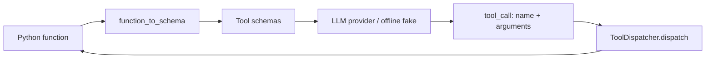

<p align="center">
  
</p>

<h1 align="center">OpenAI Function Calling Example</h1>

<p align="center">
  <strong>Generate OpenAI-style JSON tool schemas from plain Python functions, and dispatch model tool-calls back to them — in Python.</strong><br>
  Decorate a function, get its schema, hand the schema to a model, then route the tool-call dict straight back to your code.
</p>

<p align="center">
  <em>Built and maintained by <a href="https://viprasol.com">Viprasol Tech</a> — Fintech Experts. Full-Stack Builders.</em>
</p>

<p align="center">
  <a href="https://github.com/Viprasol-Tech/openai-function-calling-example/actions/workflows/ci.yml"></a>
  <a href="LICENSE"></a>
  
  <a href="https://t.me/viprasol_help"></a>
  <a href="https://github.com/Viprasol-Tech/openai-function-calling-example/stargazers"></a>
</p>

---

> **Provider-agnostic and offline-capable.** This library only turns your Python functions into tool schemas and dispatches tool-call dicts. It never calls a network or imports the OpenAI client — the schemas it produces are the exact shape the OpenAI tool-calling APIs expect, but *you* decide which provider (or none) actually runs the model. The full demo and test-suite run with **no network, no API keys, and no heavy SDKs**.

---

## Features

- **Schema from signatures** — `function_to_schema(fn)` reads type hints, defaults and the docstring to build a valid OpenAI tool schema.
- **Correct type mapping** — `int` -> `integer`, `float` -> `number`, `str` -> `string`, `bool` -> `boolean`, plus `list` -> `array` and `dict` -> `object`.
- **Required vs optional** — parameters without defaults land in `required`; `Optional[X]` / `X | None` is unwrapped to `X`.
- **Tool dispatcher** — register functions, expose their schemas, then execute `{"name": ..., "arguments": {...}}` calls with validated args.
- **Robust dispatch** — accepts dict *or* JSON-string arguments (the OpenAI wire format) and raises clear errors for unknown tools or bad args.
- **CLI** — `openai-function-calling-example demo` generates a schema and dispatches a call, fully offline.
- **Modern tooling** — ruff, mypy (strict), pytest, GitHub Actions CI.

## Quickstart

```bash
git clone https://github.com/Viprasol-Tech/openai-function-calling-example.git
cd openai-function-calling-example
python -m pip install -e ".[dev]"

# Generate a tool schema and dispatch a simulated tool call (offline):
openai-function-calling-example demo
```

## Usage — plug in a real provider

The library is provider-agnostic: it produces schemas and dispatches calls. Wire it to
any model by passing the schemas to your provider and feeding the returned tool-call
back into the dispatcher. Below, the OpenAI call is isolated behind one function — swap
it for any provider, or for the built-in offline path.

```python
from openai_function_calling_example import ToolDispatcher

dispatcher = ToolDispatcher()


@dispatcher.register
def get_weather(city: str, units: str = "celsius") -> dict[str, object]:
    """Return the current weather for a city."""
    return {"city": city, "units": units, "temperature": 21}


# 1. Hand the generated schemas to your model provider.
tools = dispatcher.schemas()

# 2. Your provider returns a tool call. With the OpenAI SDK that looks like:
#
#    from openai import OpenAI
#    client = OpenAI()
#    resp = client.chat.completions.create(
#        model="gpt-4o-mini",
#        messages=[{"role": "user", "content": "Weather in Mumbai?"}],
#        tools=tools,
#    )
#    call = resp.choices[0].message.tool_calls[0]
#    tool_call = {"name": call.function.name, "arguments": call.function.arguments}
#
#    (offline, a fake/canned provider can return the same dict shape directly.)
tool_call = {"name": "get_weather", "arguments": '{"city": "Mumbai"}'}

# 3. Dispatch it straight back to your Python function.
result = dispatcher.dispatch(tool_call)
print(result)  # {'city': 'Mumbai', 'units': 'celsius', 'temperature': 21}
```

## Architecture



## Roadmap

- [x] `function_to_schema` with type/required mapping and docstring descriptions
- [x] `ToolDispatcher` with JSON-string + dict argument support
- [x] Offline CLI demo, strict typing, full test suite
- [ ] Pydantic-model parameters -> nested JSON Schema
- [ ] Enum / Literal parameter support
- [ ] Async tool dispatch and parallel tool calls

> Note: this is an example/reference implementation — not production-hardened. Review before use.

## Contributing

PRs welcome — see [CONTRIBUTING.md](CONTRIBUTING.md) and our [Code of Conduct](CODE_OF_CONDUCT.md).

## Contact — Viprasol Tech Private Limited

- Website: [viprasol.com](https://viprasol.com)
- Email: [support@viprasol.com](mailto:support@viprasol.com)
- Telegram: [t.me/viprasol_help](https://t.me/viprasol_help) | WhatsApp: +91 96336 52112
- GitHub: [@Viprasol-Tech](https://github.com/Viprasol-Tech) | [LinkedIn](https://www.linkedin.com/in/viprasol/) | X [@viprasol](https://twitter.com/viprasol)

## License

[MIT](LICENSE) (c) 2025 Viprasol Tech Private Limited
